# 🏁 Gravity Gate

**Pinewood derby race management that runs on a Raspberry Pi.** Round-robin qualifiers that mix every den,
standings that keep each den together, a real **double-elimination** champions bracket with a classic
bracket-line view, serial gantry timer support, finish-line photos for every heat, and a live companion
site that families open by scanning a QR code.

<p align="center">
  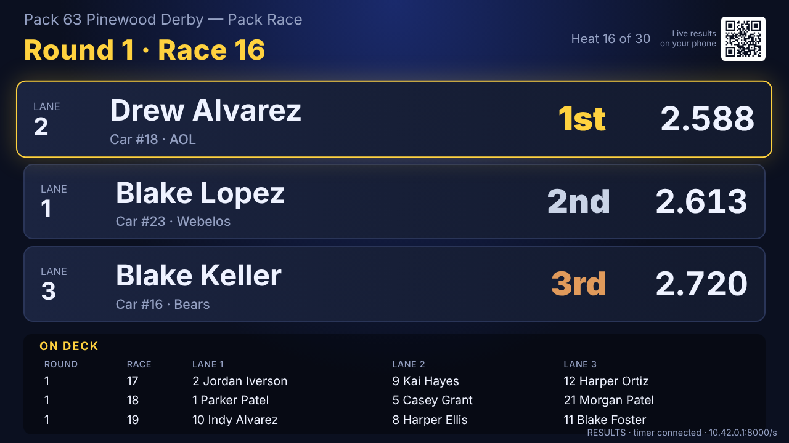
  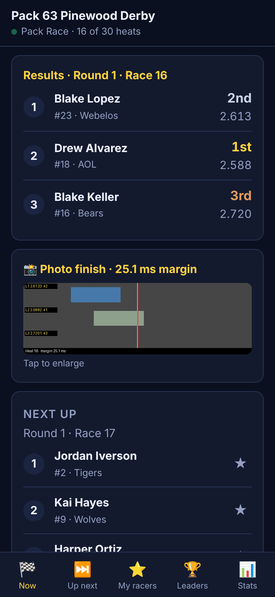
</p>

---

## Why Gravity Gate?

Most packs run their derby on an aging Windows laptop with software from the 2000s. It works, but
families can't see anything except the projector, rosters get re-typed every year, and the newer
packages have quietly dropped **double elimination**, which is the format a lot of packs still use for the
champions round.

Gravity Gate keeps every race-day function of the classic programs (Race, Standings, Awards, Manual
Entry, Rerun Last Race, Go to Next Race, Sound, Cancel Display) and adds:

- a $50 Raspberry Pi instead of a laptop,
- a phone view for every parent in the room,
- Google Sheets for rosters *and* results,
- finish-line photos, so a close heat isn't settled by arguing.

## Features

### 🏎️ Racing
The typical day is **round-robin qualifiers → per-den standings and awards → double-elimination champions bracket**.

- **Round-robin qualifiers through the lanes.** Every car runs every lane, *runs per lane* times: 3 lanes × 2 runs per lane = 6 races per car. Heats come from a rotation whose lane offsets form a modular Golomb ruler, so each car meets as many *different* opponents as possible and never races back-to-back.
- **Or a full round robin**, where every car meets every other car at least once, either within each den (dens alternate on the track) or across the pack. Heats are packed to cover the most new pairings, near the theoretical minimum count, with lanes kept as even as possible. Race control shows how many heats either choice will take before you commit.
- **Dens mixed on the track, kept together in the rankings.** Heats are drawn from the whole pack, with cars den-interleaved so heats mix dens. Standings and awards are always computed **per den and pack-wide**.
- **Standings toggle (Settings)**, which re-ranks live, mid-event if needed:
  - **Average run time** (default): the average of the counted runs decides.
  - **Heat points**: the fastest car in each heat earns as many points as there are lanes, the slowest earns 1, and a DNF earns 0.
  - **Drop runs**: keep every run, drop the slowest, or **drop the fastest and slowest** (with 6 runs, only the middle 4 count).
- **Double elimination (plus single and triple)**, generalized for 2–8 lane tracks:
  - Bracket A = undefeated, Bracket B = one loss (Bracket C for triple).
  - Balanced heats (7 cars on 3 lanes → 3, 2, 2), with byes spread fairly.
  - The bottom half (or only last place) of each heat takes a loss.
  - Rematches avoided, and each car's repeat use of a lane kept to a minimum.
  - Brackets merge into a Final once everyone fits on the track. The undefeated car still needs two losses to go out, so the "if necessary" second final happens on its own.
  - Optional **lane-rotated matchups**: each heat runs once per lane and total time decides, which answers the usual fairness complaint about elimination.
  - A dead heat on the loss boundary flags the heat for a rerun.
- **Bracket-line view.** Rounds run left to right with Bracket A on top and Bracket B below, ending in the Final and the 🏆 Champion. Gold lines carry each winner forward; red dashed lines show a car dropping to Bracket B. Boxes are ordered to minimize crossing lines. On phones, followed racers' paths are highlighted, and there's a whole-bracket overview.
- **Champions bracket from den results**: seed the bracket with the top *N* of each den from the qualifiers in one click.
- **Configurable lanes**: set 2–8 lanes, and mask off a dead lane mid-event.
- **Late arrivals** get make-up heats (one per lane, per run).
- **Rerun Last Race** never deletes data. Every attempt is kept and earlier ones are marked invalid, so the bracket recomputes itself and can't get out of sync.

<p align="center">
  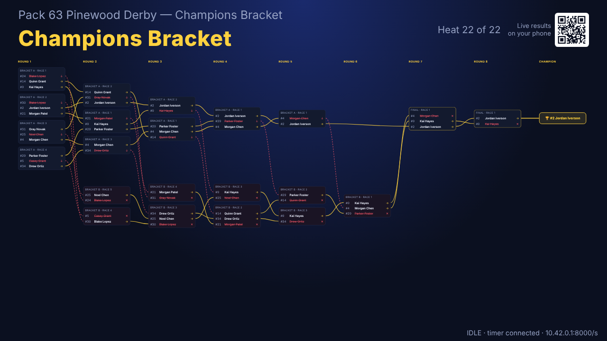
  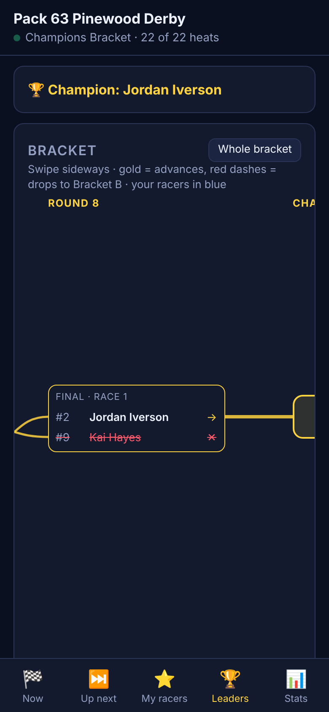
</p>

### ⏱️ Timers
- **Serial gantry timers** over USB/RS-232 with a tolerant parser for the common output formats:
  - `A=2.5060! B=2.5430" C=2.6730#` (Micro Wizard Fast Track style)
  - `1=2.5060a 2=2.5430b` (Champ style)
  - positional `1 2.5060 2 2.5430`, bare `2.5060 2.5430 2.6730`, and one-lane-per-line output
- Profiles for **Micro Wizard Fast Track, Champ, SmartLine/eTekGadget, NewBold, and PDT/Arduino** timers, plus a generic auto-detect profile.
- **Raw output log** on the race-control screen and a `gravitygate timer-capture` command, so a new timer's format takes minutes to check.
- **Simulator** with per-car speeds and lane bias, for rehearsals and training volunteers.
- **Manual Entry** by time or by place, for when the gantry acts up.

### 📸 Finish-line camera
- A Raspberry Pi camera at the finish line keeps a rolling buffer of high-frame-rate frames (Camera Module 3 ≈ 120 fps, Global Shutter Camera 200+ fps).
- **Every heat is captured** and lands in the phone gallery, so families can tap any race and see how close it was.
- **Close finishes pop up on the projector** automatically when the margin is under a threshold you set (default 10 ms).
- Two images per heat:
  - the **still** at the leader's crossing, with lanes, times, and places drawn on;
  - a **slit-scan strip**: the finish-line pixel column over time, which is how real photo-finish cameras work.
- Frames from before the timer was armed are ignored, and a short post-roll makes sure the last car is in the shot.

<p align="center">
  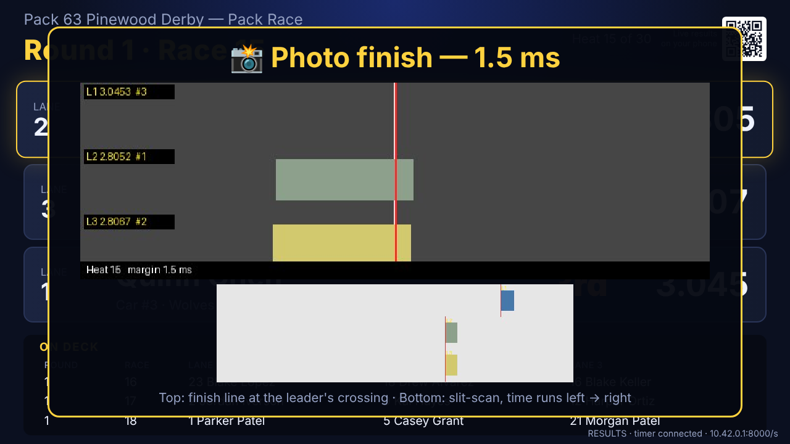
  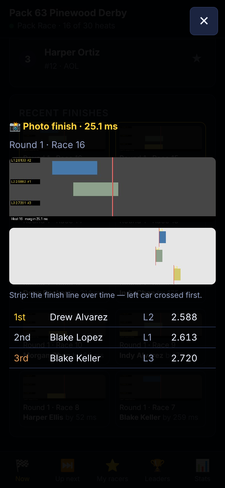
</p>

### 📱 Audience companion site
- **Scan to join**: a QR code is generated on the Pi (no internet needed) and shown on the welcome screen and in the corner of the race display. A printable `/poster` page is included. If the Pi runs its own hotspot, a **join-Wi-Fi QR** comes first.
- **Now**: the heat on the track, live results, its finish photo, and a gallery of recent finishes.
- **Up next**: the on-deck heats.
- **My racers**: star your Scout to see their next heat ("racing next, lane 2"), times, den rank, and the finish photo from each run.
- **Leaders**: per-den and pack leaderboards, or the live bracket during elimination.
- **Stats**: fastest run, scale speed (mph at 1:25), closest finish of the day, lane averages, fastest in each den, heats remaining and an ETA.

<p align="center">
  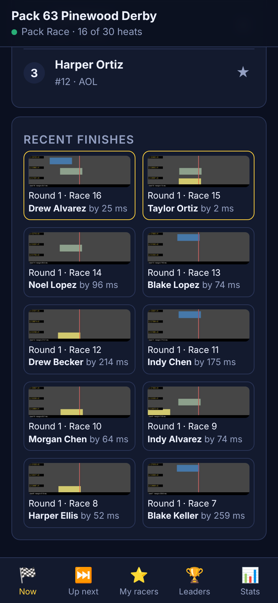
  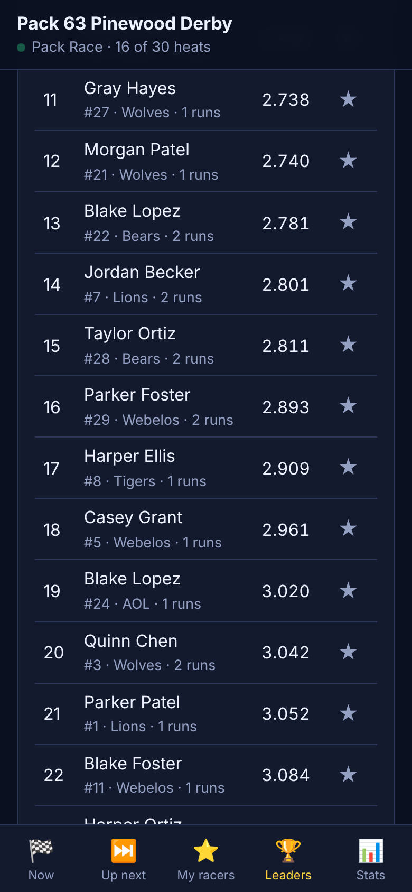
  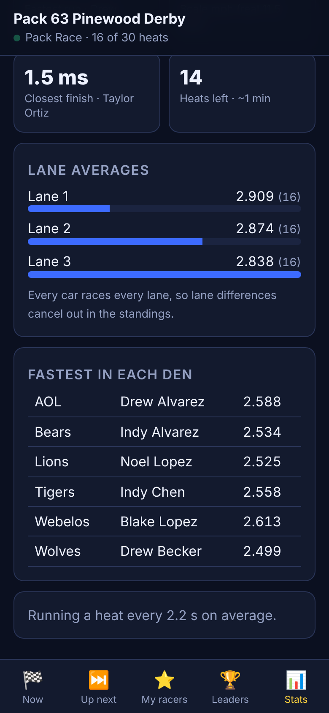
  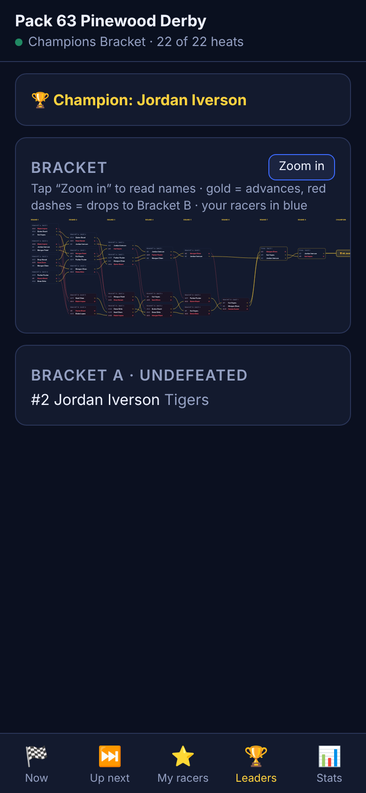
</p>

### 🖥️ Projector display
- Round · Race · Bracket header, results animating in finish order, and an on-deck table, matching the layout volunteers already know.
- Modes: **Race**, **Standings** (every den plus pack overall), **Awards** (revealed one at a time, bottom-up), **Bracket** (the bracket-line view, scaled to fit), and **Cancel Display** (a welcome screen with the QR codes).
- Synthesized sounds for staged, finish, photo finish, and award (no audio files to manage).

<p align="center">
  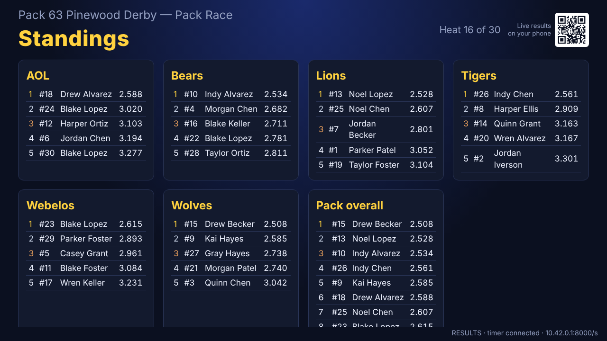
  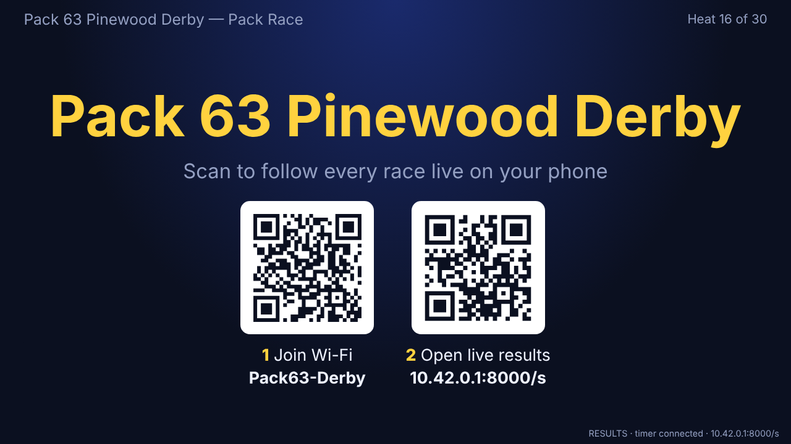
</p>

### 📋 Rosters & results in Google Sheets
- **Roster pull**: paste a Google Sheets link (any share link or a *Publish to web → CSV* link). Columns are matched by name: `Car #`, `First`, `Last` or `Name`, `Den`, `Rank`, `Checked In`. Imports upsert, never delete.
- **Results push (two-way sync)**: a 40-line Apps Script ([`deploy/google-apps-script.gs`](deploy/google-apps-script.gs)) turns your roster sheet into a sync target with no Google Cloud project. Gravity Gate writes `Gravity Gate Results` (every run), one `Standings – <session>` tab per race, and a roster tab. It never touches your own tabs.
- **Offline-first**: race day never waits on the internet. Changes queue up and push in the background with retry and backoff whenever an uplink is available.
- Service-account sync (gspread) is also supported for IT-managed packs, along with CSV export of the roster and results.

### 🧰 Race control
- One screen for the race director: Go to Next Race, Rerun Last Race, Manual Entry, Force Results, Skip Heat, display modes, Sound On/Off, timer status, and the raw timer feed.
- Check-in and inspection checkboxes, quick-add racers, den editing.
- Session management for chart races and elimination brackets, with heat lists and late-arrival make-ups.
- Optional **admin PIN**; spectator pages are always read-only.
- Optional **auto-advance** for a fast-moving track.

<p align="center">
  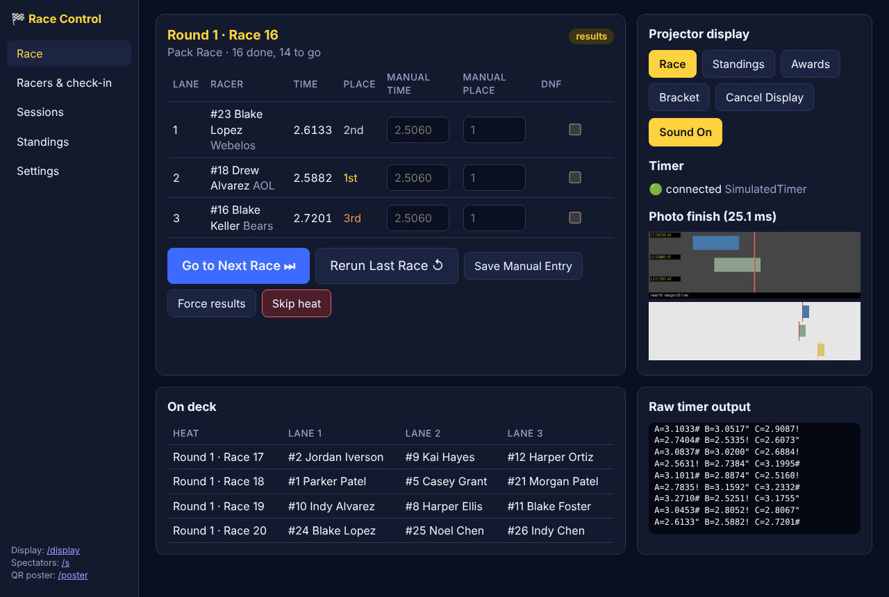
  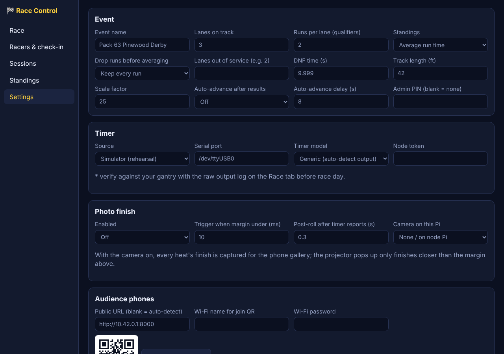
</p>

## Hardware

```
                 ┌──────────── TOP OF TRACK ────────────┐
 Start gate ───► │ Hub Pi  (gravitygate serve)          │──HDMI──► Projector  (/display)
                 │  • database, web server, Wi-Fi AP    │◄─ Wi-Fi ─ phones (/s), laptop (/admin)
                 └────────────────▲─────────────────────┘
                                  │ WebSocket (Ethernet or Wi-Fi)
                 ┌────────────────┴─────────────────────┐
 Timer gantry ──►│ Node Pi (gravitygate node)           │
 Pi camera ─────►│  • serial timer + finish-line camera │
                 └──────────── BOTTOM OF TRACK ─────────┘
```

| Setup | You need |
|---|---|
| **Single Pi** | Raspberry Pi 4/5 (2 GB+), USB-serial adapter for your timer, HDMI to the projector |
| **Two Pi** (recommended with a camera) | A second Pi at the finish line with the timer and a Pi camera (Camera Module 3, or the Global Shutter Camera for the sharpest finishes) |

The node queues results while the hub is unreachable, so a Wi-Fi blip never loses a heat.

## Quick start

### Try it on any computer (simulator, no hardware)
```bash
git clone https://github.com/Matt-Koch/gravity-gate.git
cd gravity-gate
python3 -m venv .venv && . .venv/bin/activate
pip install -e ".[dev]"
gravitygate demo-roster --count 30      # a fictional pack
gravitygate serve
```
Open <http://localhost:8000/admin>. Under **Sessions**, create a qualifier race, then click
**Go to Next Race** and **Drop gate (simulator)**. Put <http://localhost:8000/display> on a second
screen and <http://localhost:8000/s> on your phone. To see photo finishes without a camera, set
*Settings → Photo finish → Camera = Synthetic*.

### Raspberry Pi
```bash
# Hub (top of track, or a single Pi)
./deploy/install.sh hub
sudo ./deploy/setup-hotspot.sh "Pack63-Derby" "a-good-password"   # optional: the Pi becomes the Wi-Fi

# Node (bottom of track) — timer on /dev/ttyUSB0, Pi camera attached
./deploy/install.sh node ws://<hub-hostname>.local:8000 /dev/ttyUSB0 microwizard pi
```
Both install as systemd services that start on boot. Then, in **Admin → Settings**:
1. **Timer**: pick the source (serial on this Pi / node Pi), port, and model. Run a test heat and check the raw output log.
2. **Audience phones**: set the Wi-Fi name and password for the join QR, and set the public URL (e.g. `http://10.42.0.1:8000` with the hotspot).
3. **Google Sheets**: paste the roster link, plus the Apps Script URL and secret for results sync.
4. **Photo finish**: turn it on, set the close-finish margin, and calibrate the finish line.

### Verify your timer before race day
```bash
gravitygate timer-capture --serial /dev/ttyUSB0 --profile generic --lanes 3
```
Run a heat and confirm each line parses into the right lane times. The built-in profiles come from
published manuals and community notes, so please open an issue with your timer's raw output if
anything looks off.

## Google Sheets setup (5 minutes)
1. Open your roster spreadsheet → **Extensions → Apps Script**.
2. Paste [`deploy/google-apps-script.gs`](deploy/google-apps-script.gs), change `SECRET`, save.
3. **Deploy → New deployment → Web app**, execute as *Me*, access *Anyone*.
4. Paste the web app URL and secret into **Admin → Settings → Google Sheets**.
5. **Racers → Pull from Google Sheets** imports the roster. Results push automatically after every heat.

## How qualifiers are scheduled

With *C* cars, *N* lanes and *R* runs per lane, the lane round robin produces *C × R* heats (one per car
per round, at most *N* cars each), and every car races exactly *N × R* times, *R* in each lane. Car *i* in heat *h*
sits in lane *l* when *(h + offset[l]) mod C = i*. The offsets are searched so their pairwise differences are
distinct mod *C*, which gives each car the most different opponents and keeps its heats apart. Byes fill
in when there are fewer cars than lanes. Later rounds re-pair lanes and offsets so opponents change.

## How double elimination works on a multi-lane track

Classic double elimination assumes two cars per race. Gravity Gate generalizes it:

1. Every racer starts in **Bracket A** (0 losses).
2. Each round, every bracket is split into balanced heats of at most *N* cars (*N* = active lanes).
3. In each heat, the bottom half (default) or only last place takes a loss. One loss moves a car to **Bracket B**; a second loss eliminates it.
4. A lone car in a bracket gets a bye that round, and no car ever races alone.
5. When all remaining cars fit on the track, they race together in the **Final** until one car remains. A car from Bracket A still has to lose twice.
6. Placings are the champion first, then reverse order of elimination, with ties broken by best time.

With **lane-rotated matchups** on, each heat runs once in every lane and total time decides.
The engine is a pure function of heats and results, so reruns and corrections can't leave the
bracket in a bad state.

## Architecture

| Module | What it does |
|---|---|
| `gravitygate/scheduler.py` | Lane round-robin charts (runs per lane), full round robin, den interleaving, heat spacing, make-up heats |
| `gravitygate/scoring.py` | Placements, average-time and heat-point standings (per den and pack), dropped runs, awards, champion seeding |
| `gravitygate/elimination.py` | N-lane single/double/triple elimination engine |
| `gravitygate/race.py` | Race-control state machine (staged → results → next), stats, views |
| `gravitygate/timers/` | Serial timer driver, output parsers and profiles, simulator |
| `gravitygate/photofinish/` | Camera ring buffer, slit-scan, crossing detection, annotated stills |
| `gravitygate/sync.py`, `roster.py` | Google Sheets roster pull, results push, CSV import/export |
| `gravitygate/server.py` | FastAPI REST + WebSocket hub, QR codes, node link |
| `gravitygate/node.py` | Bottom-of-track agent (timer + camera → hub) |
| `gravitygate/static/` | Admin, projector display, phone companion, bracket-line renderer, and QR poster (plain HTML/JS, no build step) |

Storage is a single SQLite file in `data/`; copy it to a USB stick to back up. Everything runs offline.

## Development
```bash
pip install -e ".[dev]"
pytest
```
The tests cover the schedulers (lane balance, runs per lane, every pairing met in a full round robin, opponent variety, spacing), scoring (dropping the fastest and slowest runs, heat points), the elimination
engine (fastest car wins; nobody is eliminated before two losses; single, double and triple formats;
lane-rotated matchups; ties), timer parsing, reruns, the photo-finish pipeline, the QR endpoints,
and full API flows using the simulator.

## Roadmap / backlog
- [ ] **Dead-simple live streaming to YouTube or Facebook**: a one-click "Go live" that streams the projector display, with an optional track camera, to an RTMP stream key from the Pi.
- [ ] Finish-line camera calibration page (drag the line and lane bands on a live preview)
- [ ] Start-gate GPIO on the hub with chrony time sync between Pis, for an absolute t₀
- [ ] Printable reports: heat sheets, per-racer cards, certificates
- [ ] Importer for existing DerbyMaster data files
- [ ] Optional "DerbyMaster-compatible" elimination rules once its exact behavior is confirmed
- [ ] Hardware-verified timer profiles (contributions welcome)
- [ ] Multiple sessions running at once (e.g. siblings / adult open class)

See [`docs/PLAN.md`](docs/PLAN.md) for the full design notes.

## License
MIT. See [LICENSE](LICENSE).

*Pinewood Derby is a registered trademark of Scouting America. Gravity Gate is an independent project and is not affiliated with or endorsed by Scouting America or any timer manufacturer.*
