# Gravity Gate Setup Manual

From a box of parts to race day. This manual covers buying the hardware, building one image, booting
and arranging the boxes, connecting the timer and camera, loading your roster, a full rehearsal, and
running the event.

> **Short on time?** Read [Part 3](#part-3--boot-the-boxes-and-give-them-jobs) and
> [Part 8](#part-8--race-day), and print the [race-day card](RACE-DAY.md).

<p align="center">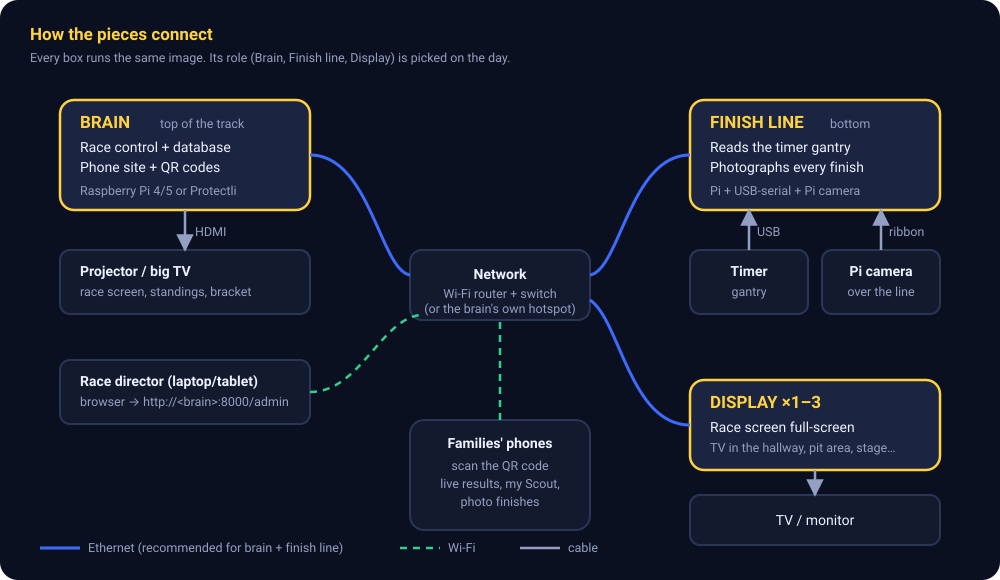</p>

## Contents

- [Part 1 — What you need](#part-1--what-you-need)
- [Part 2 — Build the image](#part-2--build-the-image)
- [Part 3 — Boot the boxes and give them jobs](#part-3--boot-the-boxes-and-give-them-jobs)
- [Part 4 — Set up the track: timer and finish-line camera](#part-4--set-up-the-track-timer-and-finish-line-camera)
- [Part 5 — First-time settings in race control](#part-5--first-time-settings-in-race-control)
- [Part 6 — Roster and Google Sheets](#part-6--roster-and-google-sheets)
- [Part 7 — Rehearse](#part-7--rehearse)
- [Part 8 — Race day](#part-8--race-day)
- [Part 9 — Troubleshooting](#part-9--troubleshooting)
- [Appendix](#appendix) (single-computer setup, updating, backups, reference)

---

## Part 1 — What you need

### The boxes

Gravity Gate runs on small computers that we call **boxes**. Every box gets the same software; you
decide on the day what each one does:

| Role | What it does | Typical hardware |
|---|---|---|
| **Brain** (exactly one) | Race control, the database, the phone website, QR codes. Usually also drives the projector. | Raspberry Pi 5 or 4 (4 GB), or a Protectli / mini PC |
| **Finish line** (one) | Reads the timer gantry over USB, photographs every finish. | Raspberry Pi 4/5 + Pi camera |
| **Display** (any number) | Shows the race screen full-screen on a TV: hallway, pit area, second screen. | Any Pi 4/5 or mini PC with HDMI |

A typical pack uses **3–4 boxes**. One box can do several jobs (the brain can also be a display), and the
smallest setup is a single box doing everything ([Appendix A](#a-one-computer-setup-no-fleet)).

### Shopping list

| Item | Notes |
|---|---|
| Raspberry Pi 5 or 4 (2 GB minimum, 4 GB recommended) ×3–4 | Or x86 mini PCs such as Protectli. You can mix them. |
| Official power supply for each Pi | Under-powered Pis cause odd crashes. Pi 5: 27 W USB-C. Pi 4: 15 W USB-C. |
| microSD card per Pi, 32 GB, A1/A2 rated | Buy one spare. |
| Micro-HDMI → HDMI cable per Pi | Pi 4 and 5 use **micro**-HDMI. |
| USB keyboard (one is enough) | Only needed while assigning roles; move it from box to box. |
| Monitor or TV for each box during setup | The projector and TVs you race with work fine. |
| **USB-serial adapter** for the timer | Most gantry timers have a DB9 serial port. Get an FTDI- or Prolific-based adapter. Many newer timers have USB built in. |
| **Raspberry Pi Camera Module 3** (or the Global Shutter Camera) + a longer ribbon cable | Optional; enables photo finishes. Get a 30–50 cm ribbon so the Pi can sit beside the track. |
| Camera mount | A desk lamp arm, a small tripod, or a strip of wood clamped over the finish line. |
| **Wi-Fi router + small Ethernet switch** | Strongly recommended. A $30 travel router works. See [network options](#network-options). |
| Ethernet cables | For the brain and the finish-line box at least. |

### Network options

All boxes and phones must be on **the same local network**. Two ways to do that:

1. **Your own router (recommended).** Bring a cheap Wi-Fi router, plug the brain and finish-line
   box into it with Ethernet, and have families join its Wi-Fi. You control everything, and nothing
   depends on the building's network. Turn **off** "client isolation" or "AP isolation" if your router has it.
2. **The brain is the Wi-Fi.** `deploy/setup-hotspot.sh` turns the brain's built-in Wi-Fi into a
   hotspot (address `10.42.0.1`). Simple, but the other boxes must then be wired to the brain through
   a switch, or be set up to join that hotspot. It's fine for small events.

> ⚠️ **Avoid building guest Wi-Fi.** Guest networks usually block devices from talking to each other.
> The boxes would never find each other, and phones couldn't reach the brain.

---

## Part 2 — Build the image

You will set up **one** box completely, then copy its SD card (or disk) to the others. If you only have
2–3 boxes, it's just as easy to repeat [step 2.2](#22-install-gravity-gate) on each one.

### 2.1 Install the operating system

**Raspberry Pi:** use [Raspberry Pi Imager](https://www.raspberrypi.com/software/).

1. **Device:** your Pi model. **OS:** *Raspberry Pi OS (other)* → **Raspberry Pi OS Lite (64-bit)**.
   Lite has no desktop. Gravity Gate draws its own screens, so a desktop isn't needed.
2. **Edit settings** (OS customisation):
   - Hostname: `gravitygate`. Each box renames itself later, so don't worry about clashes.
   - Username and password: anything you'll remember (you'll use them over SSH).
   - Wi-Fi: optional, only for the box you're setting up right now.
   - Services → **Enable SSH** (password authentication).
3. Write the card, put it in the Pi, connect Ethernet, keyboard, monitor and power.

**Protectli / mini PC:** install **Debian 12** from the netinst image. In the installer's software
selection, untick *Debian desktop environment* and tick **SSH server** and **standard system utilities**.

### 2.2 Install Gravity Gate

Log in on the box, or over SSH from a laptop (`ssh yourname@gravitygate.local`), and run:

```bash
sudo apt update && sudo apt install -y git
sudo git clone https://github.com/Matt-Koch/gravity-gate.git /opt/gravity-gate
sudo /opt/gravity-gate/deploy/install-fleet.sh "pick-a-fleet-passphrase"
```

The passphrase is optional but recommended. Use **the same one on every box**: it signs the
messages between boxes, so a stray laptop on the network can't pretend to be your brain.

The installer takes 5–15 minutes. It:

- installs Python, the kiosk browser (Chromium inside `cage`, a minimal full-screen window manager), and the Pi camera library;
- creates a `gravitygate` user for running races, with access to video, camera and serial ports;
- puts Gravity Gate in charge of the HDMI console (tty1) instead of a login prompt.

When it finishes, the monitor switches to the Gravity Gate screen
([Part 3](#part-3--boot-the-boxes-and-give-them-jobs)). That's the sign it worked.

### 2.3 Copy the card to the other boxes

Skip this if you ran the installer on every box.

1. On the finished box, clear everything that must be unique per machine, and shut it down:
   ```bash
   sudo /opt/gravity-gate/deploy/prepare-image.sh
   sudo poweroff
   ```
   This clears saved roles, logs and race data, resets the hostname and the system machine ID, and
   on Raspberry Pi OS removes the SSH host keys so each copy makes its own. Each box's Gravity Gate
   **ID comes from its own network hardware**, so copies never clash.
2. Read the card into an image file on a computer:
   - **Windows:** *Win32 Disk Imager* → choose the card → **Read**.
   - **Mac / Linux:** `sudo dd if=/dev/sdX of=gravity-gate.img bs=4M status=progress`
     (find the right `/dev/...` with `lsblk` or `diskutil list`; get it wrong and you erase the wrong disk).
   - Optional: shrink it with [PiShrink](https://github.com/Drewsif/PiShrink) so it fits on any 32 GB card.
3. Write the image to each new card with Raspberry Pi Imager → **Choose OS** → **Use custom**.
   For Protectli boxes, use Clonezilla to copy the disk. On Debian, run
   `sudo dpkg-reconfigure openssh-server` once on each copy to give it its own SSH keys.

---

## Part 3 — Boot the boxes and give them jobs

<p align="center">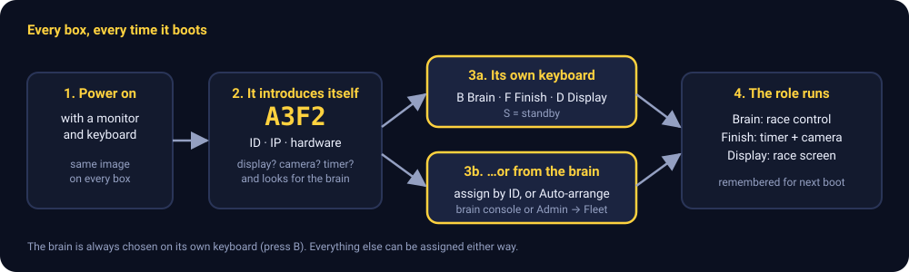</p>

### 3.1 Power everything on

Connect every box to the network and to a monitor or TV, then power them on. After about 30 seconds,
each screen shows its **machine setup** page:

<p align="center">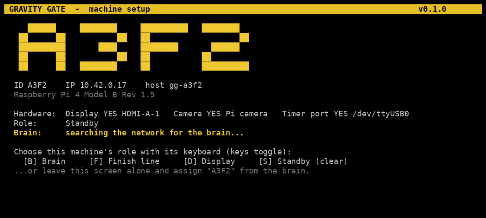</p>

| On the screen | Meaning |
|---|---|
| Big **A3F2** | This box's ID: the last 4 characters of its network hardware address. It never changes. Write it on a sticker on the box. |
| **IP** | Its address on the network. |
| **Hardware** | What Gravity Gate detected: a monitor on HDMI, a Pi camera, a timer's USB-serial adapter. |
| **Role** | What it's doing now. A fresh box starts on **Standby**. |
| **Brain** | Whether it has found the brain. Until a brain exists, it keeps searching. |

### 3.2 Choose the brain

Walk to the box that will run race control (usually the one by the projector), and press **B**:

<p align="center">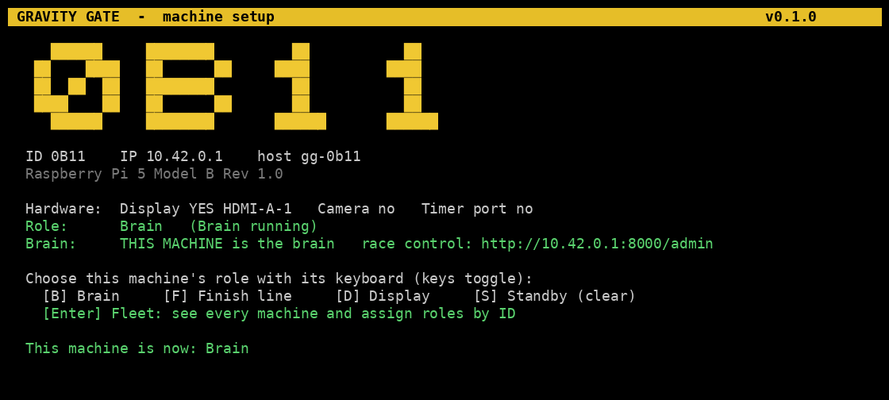</p>

The race server starts, and the screen shows the **race-control address**, e.g.
`http://10.42.0.1:8000/admin`. Open that on the race director's laptop or tablet.

Within a few seconds, every other box's screen changes to **Brain: connected to http://…**.

> The brain is always chosen on its own keyboard, so two boxes can never fight over it. If you press
> **B** while another brain is already running, it asks you to press **B** again to confirm, and
> both screens warn about it. Keep only one.

### 3.3 Assign the other boxes

Pick whichever of these three ways is handiest.

**A. From the brain's own keyboard.** Press **Enter** on the brain to open the Fleet screen:

<p align="center">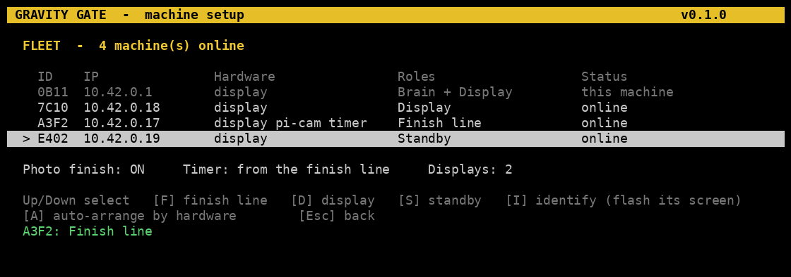</p>

- **↑ ↓** select a box, then press **F** (finish line), **D** (display) or **S** (standby). F and D toggle on and off.
- **A** auto-arranges everything from the hardware: the box with a timer port and camera becomes the
  finish line, and boxes with a monitor attached become displays.
- **I** makes the selected box's screen flash its ID, so you can find it in the gym:

<p align="center">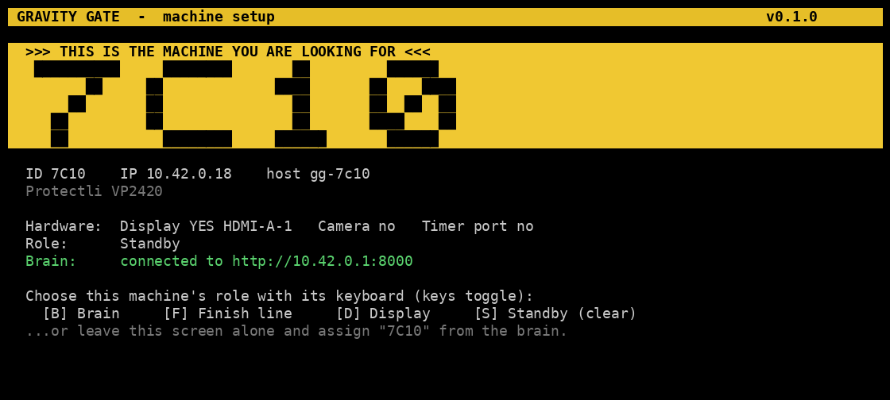</p>

- **Esc** goes back.

**B. From race control.** Open **Admin → Fleet** on the laptop. It has the same list, with buttons:

<p align="center">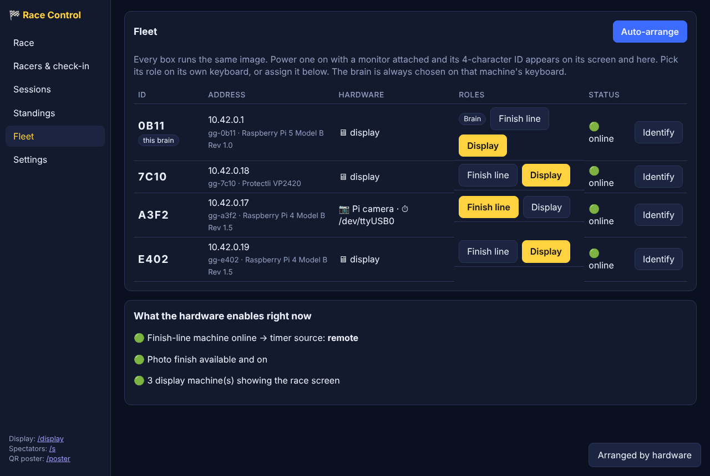</p>

**C. On the box itself.** Press **F** or **D** on that box's keyboard.

A box that gets the **Display** role switches its HDMI to the full-screen race screen within a few
seconds. To see its setup page again, press **Ctrl+Alt+F1** on its keyboard. **Ctrl+Alt+F7** (or F2–F6,
depending on the system) returns to the race screen. If a shortcut doesn't respond,
`sudo systemctl restart gravitygate-agent` over SSH brings the setup page back.

<p align="center">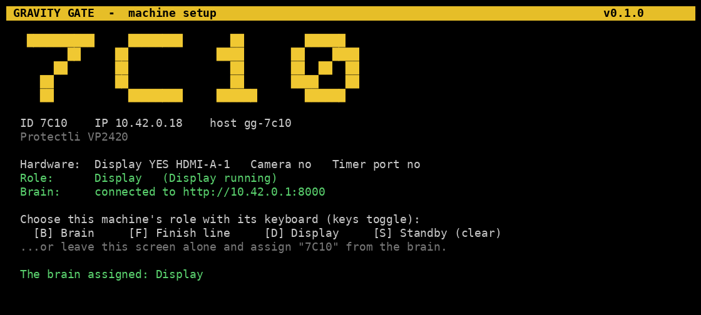</p>

Roles are saved on each box and on the brain. Next time you power everything on, each box goes
straight back to its job. Only the brain needs to be up for the others to work.

### 3.4 What turns on automatically

The bottom panel of **Admin → Fleet** shows what your hardware enables right now:

- **Finish-line box online** → the timer source switches to it automatically.
- **Finish-line box with a Pi camera** → photo finish turns on. With no camera, the photo features
  stay hidden instead of showing empty boxes.
- **Display boxes** → listed with the count of screens showing the race.

---

## Part 4 — Set up the track: timer and finish-line camera

<p align="center">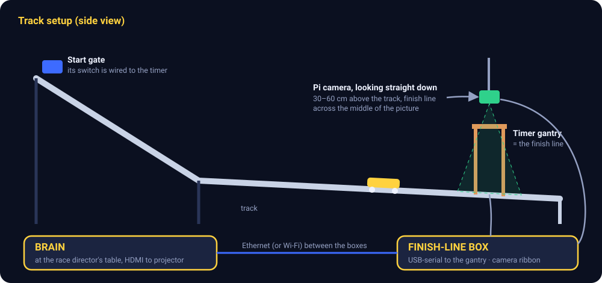</p>

### 4.1 Connect the timer

1. Connect the timer as its manual says: the start-gate switch goes to the timer, and the gantry sits on the finish line.
2. Plug the timer's serial cable, through the USB-serial adapter, into the **finish-line box**.
3. That box's setup page should now show **Timer port YES /dev/ttyUSB0** (or `/dev/ttyACM0`).
4. In **Admin → Settings → Timer**, set **Timer model** to your timer and **Save settings**.
   Pick **Generic** if yours isn't listed: it understands the common formats.

**Check the timer is understood.** Go to **Admin → Race**, then **Go to Next Race**, then run a car down. Watch
the **Raw timer output** box. Every line the timer sends appears there, and the heat's times fill in:

<p align="center">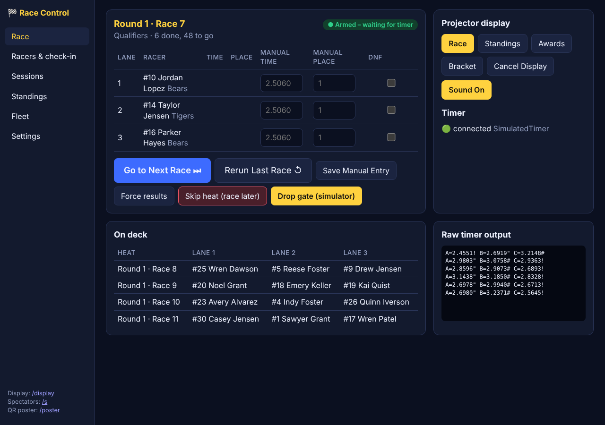</p>

If lines appear in the raw log but no times fill in, the format isn't recognised. Copy a few raw
lines into a GitHub issue and we'll add your timer. Meanwhile **Manual Entry** works for everything.

> ⚠️ If the Race tab offers a yellow **Drop gate (simulator)** button and the timer line says
> *SimulatedTimer*, the timer **isn't** connected. Gravity Gate fell back to the practice simulator.
> Check the finish-line box's setup page for *Timer port YES*.

### 4.2 Mount the camera (optional, for photo finishes)

1. Connect the Pi camera to the finish-line box with the ribbon cable, with the box powered **off**.
   The ribbon's contacts face the board's contacts; check the Raspberry Pi camera guide for your model.
2. Mount the camera **30–60 cm above the finish line, looking straight down**:
   - the cars cross the picture **left to right**;
   - each lane is a horizontal stripe;
   - the finish line runs up and down the middle of the picture.
3. Power on. The setup page should show **Camera YES Pi camera**.

### 4.3 Calibrate the camera

<p align="center">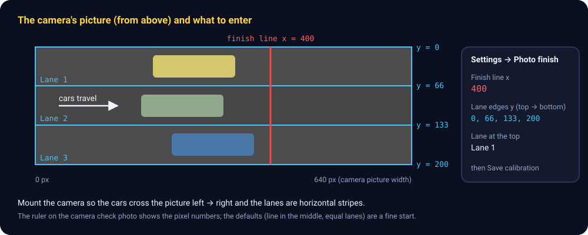</p>

1. Open **Admin → Settings → Photo finish** and click **Take camera check photo**.
2. You'll see the camera's live view with the current guesses drawn on:
   - a **red line** for the finish line;
   - **blue boxes** for the lanes;
   - a pixel ruler along the top.

<p align="center">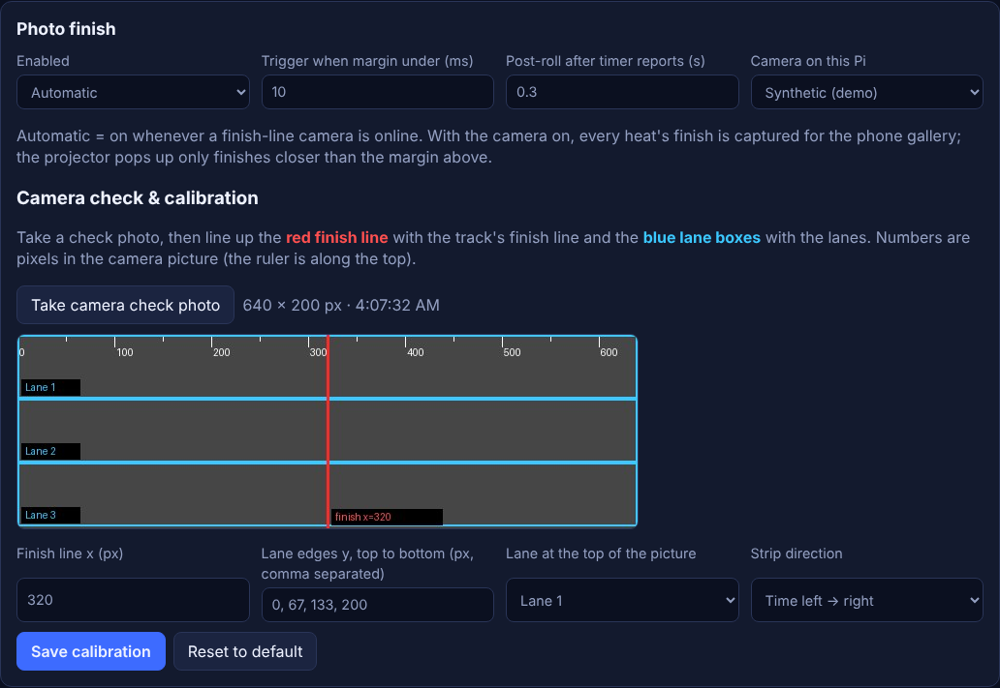</p>

3. Adjust the fields, then click **Save calibration**. It takes a fresh check photo so you can see the result.
   - **Finish line x:** the ruler number where the real finish line is.
   - **Lane edges y:** the stripe boundaries from top to bottom, one more number than lanes
     (3 lanes → 4 numbers, e.g. `0, 66, 133, 200`).
   - **Lane at the top of the picture:** whether lane 1 or your highest lane is at the top.
4. Repeat until the red line sits on the real finish line and each blue box covers one lane.

Two more settings in the same card:

- **Trigger when margin under (ms):** finishes closer than this (default 10 ms) pop up on the
  projector. Every heat is photographed for phones either way.
- **Post-roll:** how long the camera keeps recording after the timer reports. The default 0.3 s
  makes sure the last car is in the picture.

> The photo shows how close it was; **the timer stays the official result**. At 120–200 frames per
> second, one frame is 5–8 ms. If a parent challenges a result, the photo helps, and **Manual Entry**
> lets you correct it.

---

## Part 5 — First-time settings in race control

Open **Admin → Settings** on the race director's laptop. Click **Save settings** at the bottom when done.

<p align="center">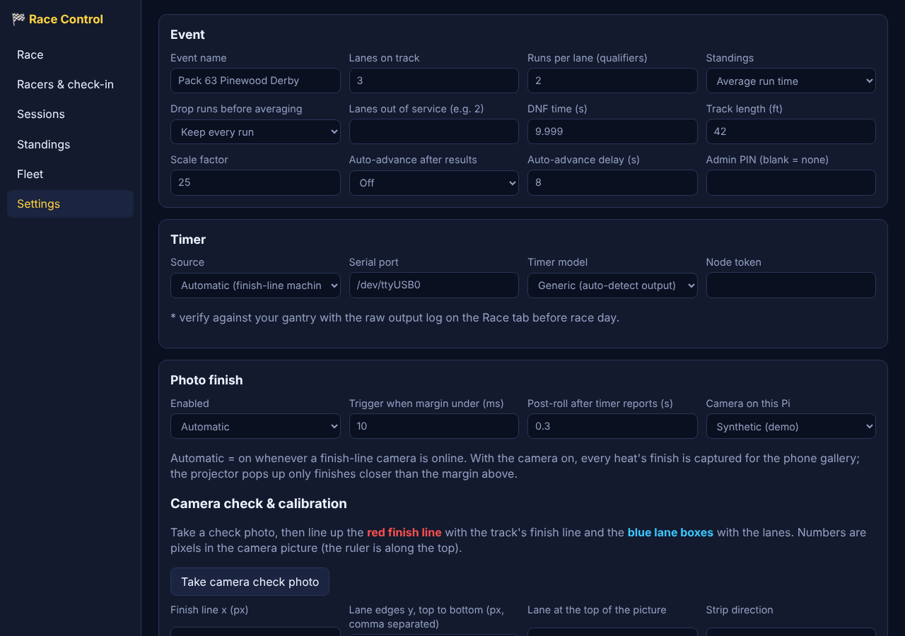</p>

### Event

| Setting | What to put |
|---|---|
| **Event name** | Shown on the projector, phones and poster, e.g. *Pack 63 Pinewood Derby*. |
| **Lanes on track** | Your track's lane count (2–8). |
| **Runs per lane** | Qualifier races per lane per car. 3 lanes × 2 runs = **6 races per car**. |
| **Standings** | **Average run time** (the default) or **Heat points**: in each heat the fastest earns as many points as there are lanes, the slowest earns 1. |
| **Drop runs before averaging** | Keep every run, drop the slowest, or **drop the fastest and slowest**. With 6 runs, the middle 4 count. |
| **Lanes out of service** | If a lane breaks, enter its number (e.g. `2`). Races you create **after** saving skip that lane; a race already in progress keeps its heats, so record that lane with **Manual Entry** (tick DNF) for those. |
| **DNF time** | The time counted for a car that doesn't finish (default 9.999 s). |
| **Track length / Scale factor** | Used for the "scale mph" stat on phones (default 42 ft and 1:25). |
| **Auto-advance** | Moves to the next heat by itself a few seconds after results. Most packs leave it **Off** so the announcer controls the pace. |
| **Admin PIN** | Set one! Without it, anyone on the Wi-Fi who finds `/admin` can press buttons. Phones and the projector never need it. |

You can change **Standings** and **Drop runs** mid-event. Standings re-rank instantly, with no re-racing.

### Timer
**Source: Automatic** uses the finish-line box when one is online, otherwise a USB timer plugged
into the brain, otherwise the practice simulator. Leave it on Automatic unless you have a reason not to.
Set **Timer model** as in [4.1](#41-connect-the-timer).

### Audience phones

<p align="center">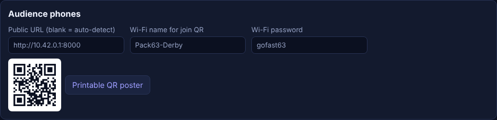</p>

- **Public URL:** usually leave it blank; the brain works out its own address. If phones can't open
  the QR link, put the address phones should use here, e.g. `http://10.42.0.1:8000`.
- **Wi-Fi name / password:** fill these in and the projector's welcome screen and the poster show a
  **join-Wi-Fi QR** first, so phones connect without typing.
- **Printable QR poster:** print a few for the doors, the check-in table and the stands.

<p align="center">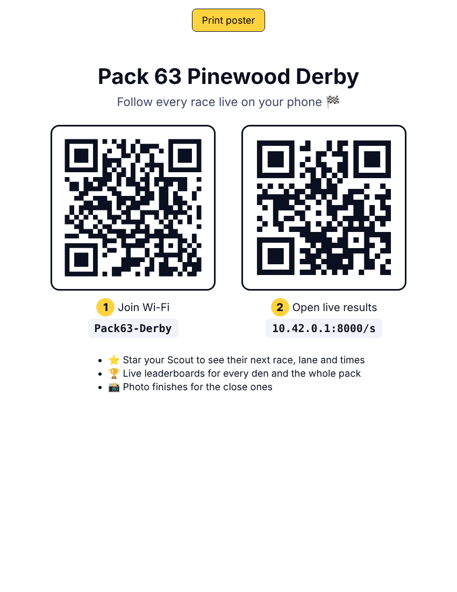</p>

---

## Part 6 — Roster and Google Sheets

### 6.1 Prepare the sheet

Make a Google Sheet with one row per Scout. Gravity Gate matches columns by name, so order doesn't
matter and extra columns are ignored:

| Car # | First | Last | Den | Checked In |
|---|---|---|---|---|
| 1 | Avery | Alvarez | Wolves | |
| 2 | Blake | Becker | Bears | |

Also accepted: a single **Name** column instead of First/Last, **Rank**, and variations such as
`Car`, `Car Number`, `First Name`.

### 6.2 Pull the roster (no setup)

1. In Google Sheets choose **Share → Anyone with the link → Viewer**, and copy the link.
2. Paste it in **Admin → Settings → Google Sheets → Roster sheet link** and save.
3. **Admin → Racers & check-in → Pull from Google Sheets**.

Pulling again later adds new Scouts and updates changed ones. It never deletes anyone. You can
also **Import CSV** from a file, or add racers one at a time.

### 6.3 Send results back to the sheet (5-minute setup)

This lets Gravity Gate write results into your spreadsheet automatically after every heat. You need
it set up once, ideally a few days before the event.

1. In your roster spreadsheet: **Extensions → Apps Script**.
2. Delete what's there and paste the contents of
   [`deploy/google-apps-script.gs`](../deploy/google-apps-script.gs).
3. Change `const SECRET = 'change-me';` to a passphrase of your own. If your roster tab isn't called
   `Roster`, change `ROSTER_TAB` too. Click **Save**.
4. **Deploy → New deployment →** gear icon **→ Web app**:
   - *Execute as:* **Me**;
   - *Who has access:* **Anyone**;
   - click **Deploy**, and approve the permissions Google asks for.
5. Copy the **Web app URL**.
6. In **Admin → Settings → Google Sheets**, paste it into **Apps Script web app URL**, put your
   passphrase in **Sync secret**, and save.

<p align="center">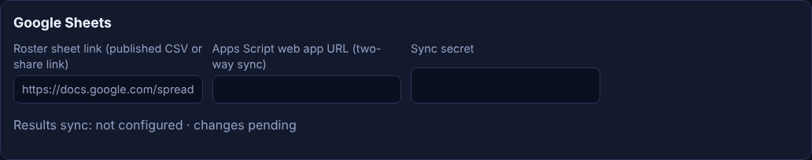</p>

From now on Gravity Gate keeps these tabs up to date:

- **Gravity Gate Results**: every run;
- **Standings – *session name***: one tab per race;
- **Gravity Gate Roster**.

It only ever writes tabs whose names start with *Gravity Gate* or *Standings –*; your own tabs are
never touched. Results sync is **offline-first**: if the building has no internet, results wait and
upload when a connection appears. The status line under the settings shows the last successful push.

### 6.4 Check-in

<p align="center">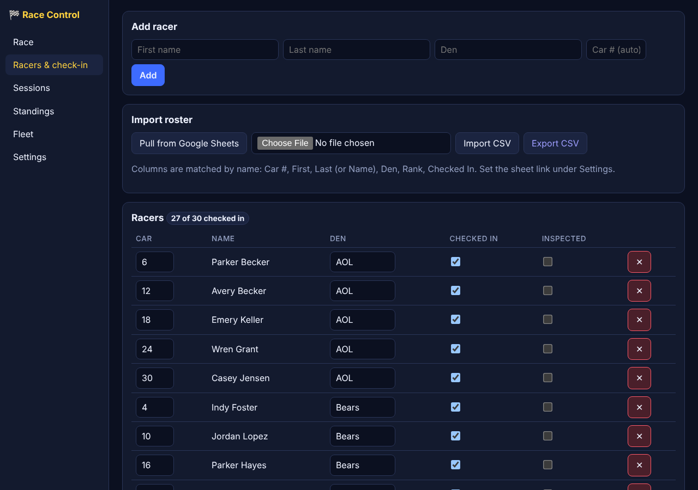</p>

As cars arrive, tick **Checked in** (and **Inspected** if you weigh and inspect). Only checked-in
racers are included when you create a race.

---

## Part 7 — Rehearse

Do a full dress rehearsal a few days before, with every box set up where it will be on the day.
Nothing about the rehearsal touches the real event.

1. In **Admin → Sessions → New qualifier race**, keep all dens ticked and click **Create & activate**.
   The estimate under the form tells you how many heats and roughly how long it will take.

   <p align="center">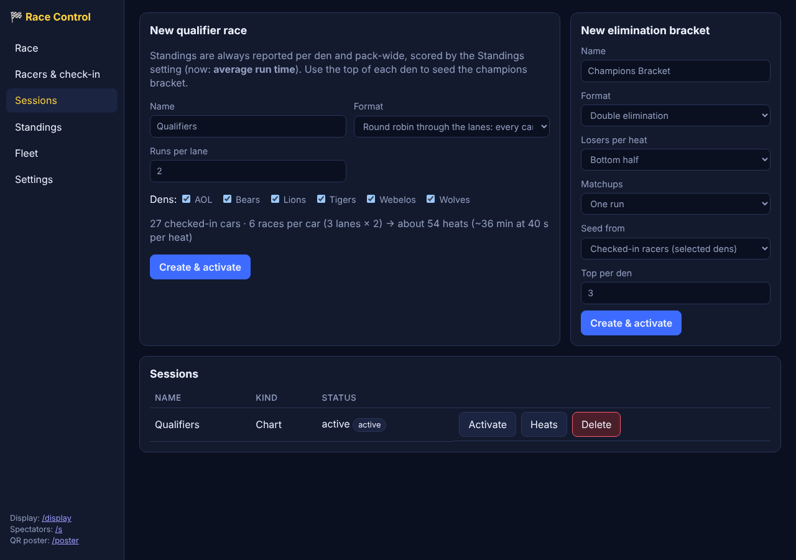</p>

2. **Admin → Race → Go to Next Race**. Run real cars (or press **Drop gate (simulator)** if no timer is
   connected yet). Check that:
   - the projector shows the heat and the results;
   - the raw timer log shows lines;
   - a photo appears for each heat (if you have the camera).
3. Scan the QR code with a phone. Follow a racer (★), and check **Now**, **Up next**, **My racers**, **Leaders** and **Stats**.
4. Try **Rerun Last Race**, **Manual Entry** and **Skip heat (race later)** so the race director has used them before.
5. Try the display modes: **Standings**, **Awards** (click *Reveal next award*), and **Cancel Display**
   (the welcome screen with QR codes).
6. Delete the rehearsal session (**Sessions → Delete**) when done.

---

## Part 8 — Race day

<p align="center">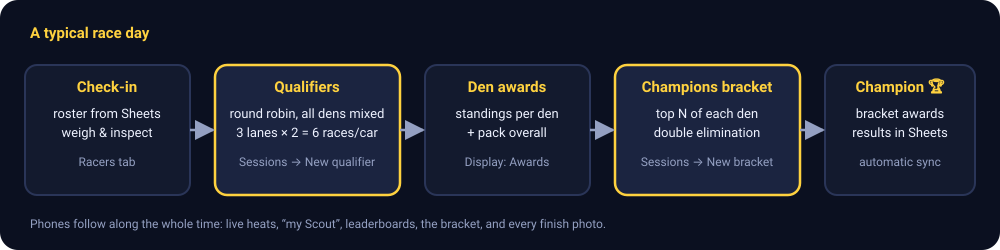</p>

### 8.1 Before the doors open
- Power on everything. The brain first is nice but not required; every box finds it within seconds.
- Check **Admin → Fleet**: every box is online with the right role, and the panel says the timer source is the finish line.
- Run one test car. Times appear and the photo appears.
- Put the projector on **Cancel Display** (the welcome screen) so arriving families can scan the QR code.

<p align="center">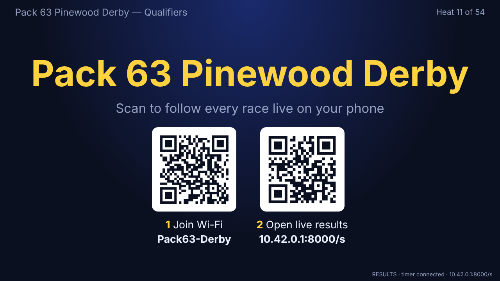</p>

### 8.2 Qualifiers
1. Check in the cars ([6.4](#64-check-in)).
2. **Sessions → New qualifier race → Create & activate.** Every car races every lane, and heats mix
   cars from all dens. Standings are always reported per den and for the whole pack.
3. On the **Race** tab, the rhythm is:
   1. **Go to Next Race**: the projector shows who's up; the announcer calls the cars.
   2. Cars go in the lanes shown, the gate drops, and the results appear automatically.
   3. Repeat.

<p align="center">
  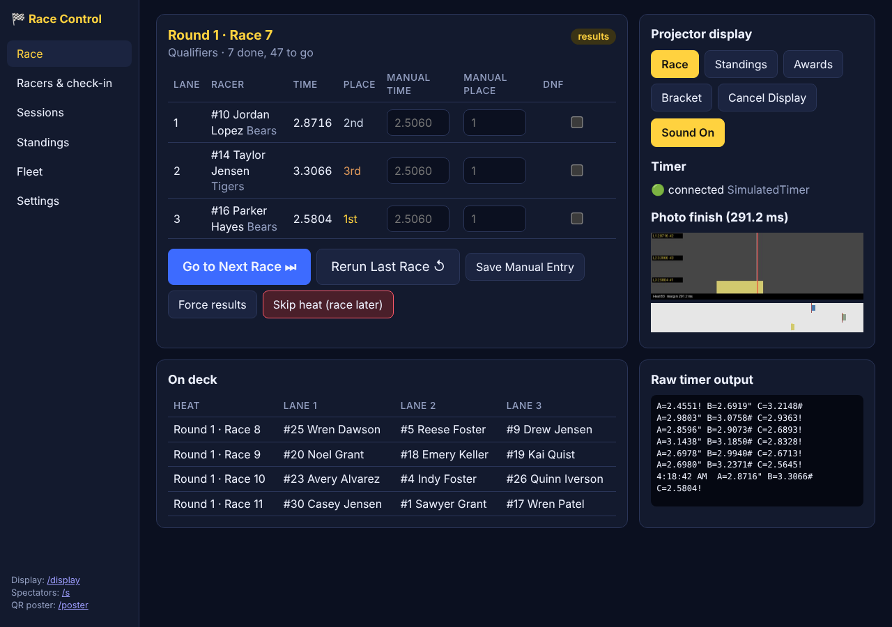
  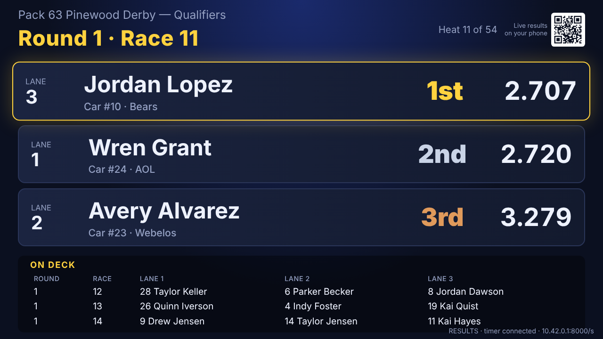
</p>

| Button | When to use it |
|---|---|
| **Go to Next Race** | Accept the results and stage the next heat (it also arms the timer). |
| **Rerun Last Race** | A car jumped the track, a lane was blocked, the gate stuck. The last results are discarded (kept in history) and the same heat is re-armed. |
| **Save Manual Entry** | The timer missed something. Type each lane's time, *or* just its place, then save. |
| **Force results** | The timer is waiting for a car that will never finish (e.g. it fell off). Tells the timer to report now. |
| **Skip heat (race later)** | A car needs a quick repair. The heat moves to the end of the queue with the same name, so nobody loses a run. |
| **Sound On/Off** | Projector sounds for staged, finish, photo finish and awards. |

Close finishes pop up on the projector by themselves:

<p align="center">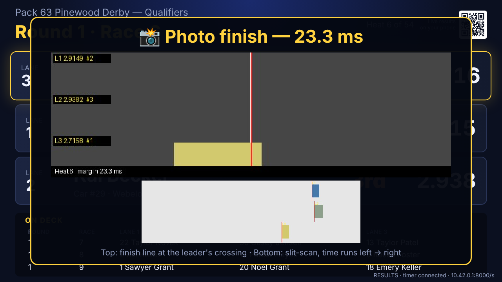</p>

**Late arrival?** **Sessions → Heats → Add make-up heats** gives a late car one heat per lane.

### 8.3 Den awards
When the qualifiers finish:

1. **Standings** tab: check the results. Ties are marked with `=` and *(tie!)*.

   <p align="center">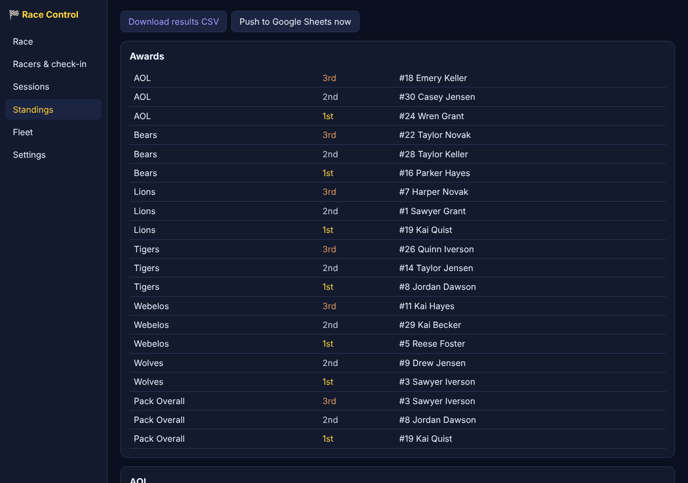</p>

2. Projector **Awards**: click **Reveal next award** for each award. It reveals from 3rd place to 1st, den by den, then the pack overall.

<p align="center">
  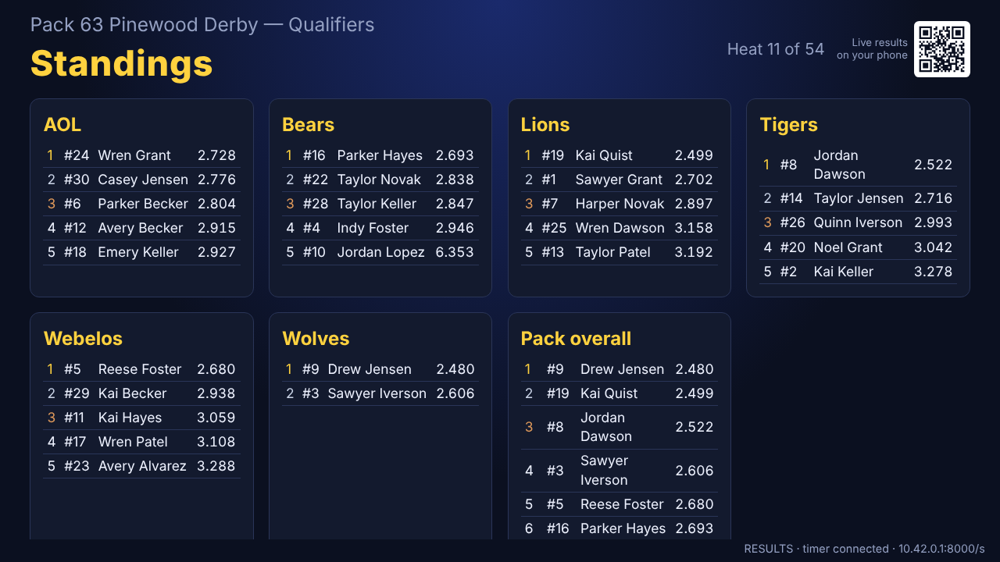
  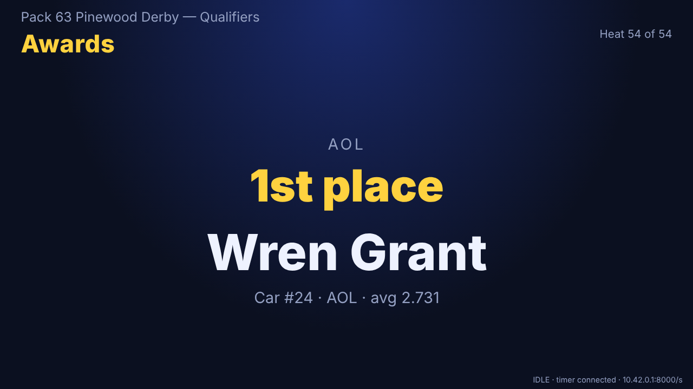
</p>

### 8.4 Champions bracket (double elimination)
1. **Sessions → New elimination bracket**:
   - **Format:** Double elimination.
   - **Seed from:** *Top of each den in "Qualifiers"*.
   - **Top per den:** how many from each den advance (2 or 3 is typical).
   - **Create & activate.**
2. Race it exactly like the qualifiers: **Go to Next Race**, run, repeat. The brain builds each new round
   by itself as soon as the previous one finishes.
3. Show the **Bracket** on the projector between heats. Gold lines carry winners forward; red
   dashed lines show a car dropping to Bracket B. It ends at the 🏆 Champion.

<p align="center">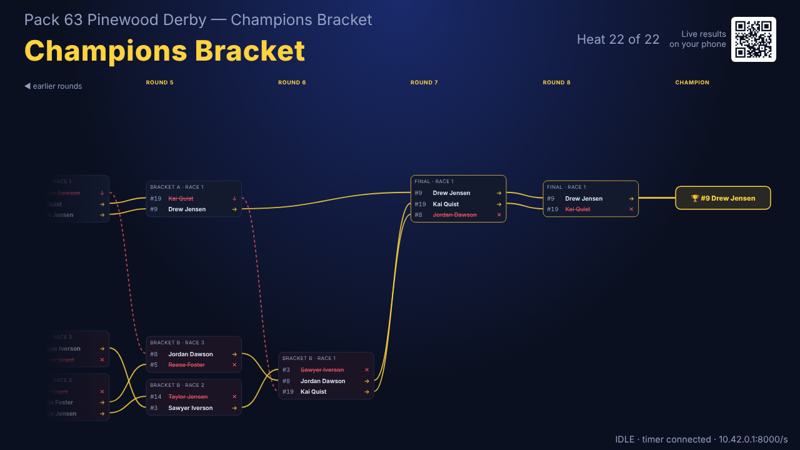</p>

How it works on a multi-lane track:

- Every car starts in **Bracket A**. In each heat, the slower half takes a loss and moves to **Bracket B**.
- A second loss and the car is out.
- When everyone left fits on the track, they race the **Final** together, and the undefeated car must
  still lose twice. If a dead heat decides who takes a loss, the heat is flagged for a rerun.

### 8.5 What families see
Phones follow along the whole time: the current heat, who's up next, their own Scout's next race and
lane, leaderboards, the bracket, and the photo of every finish.

<p align="center">
  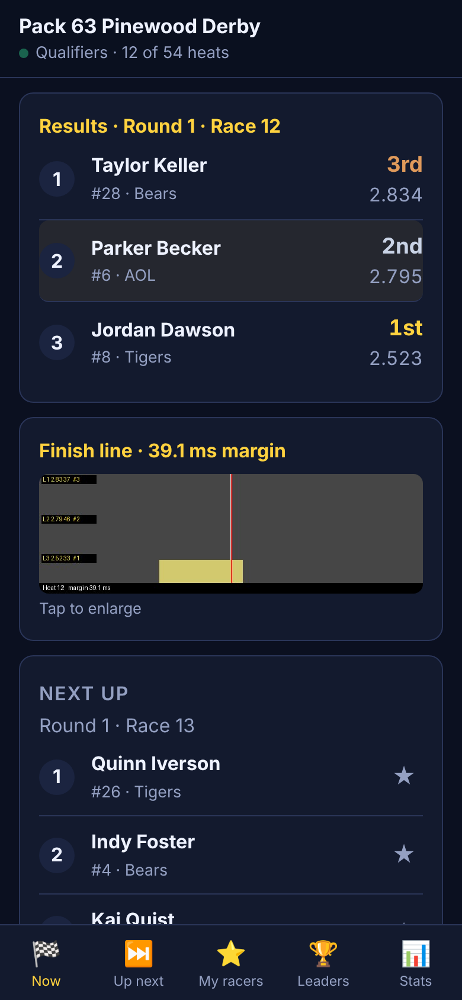
  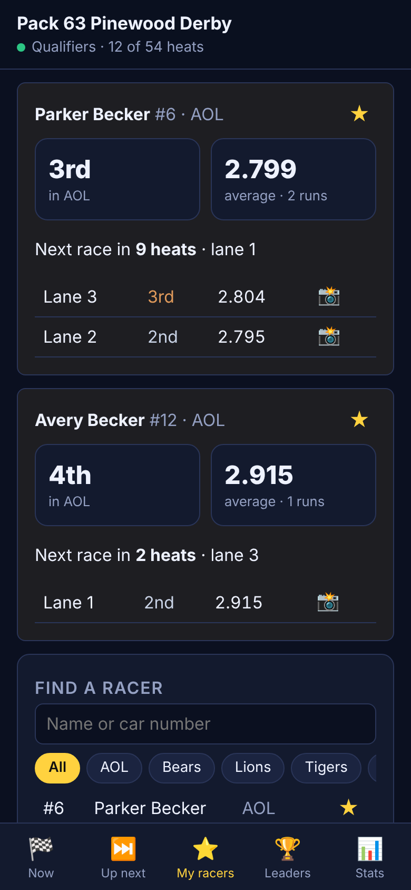
  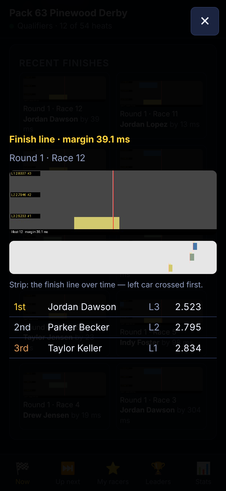
  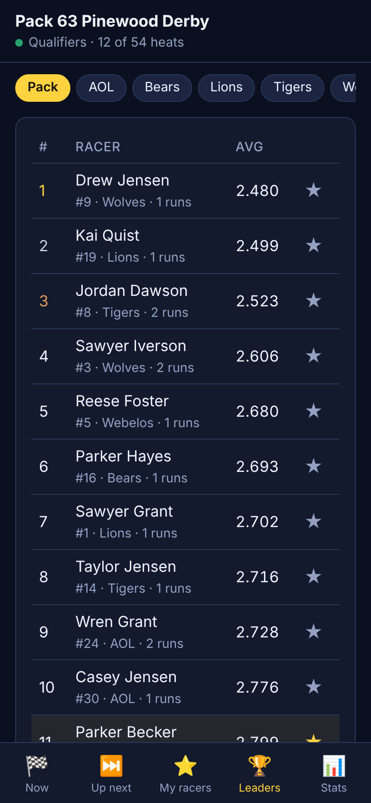
  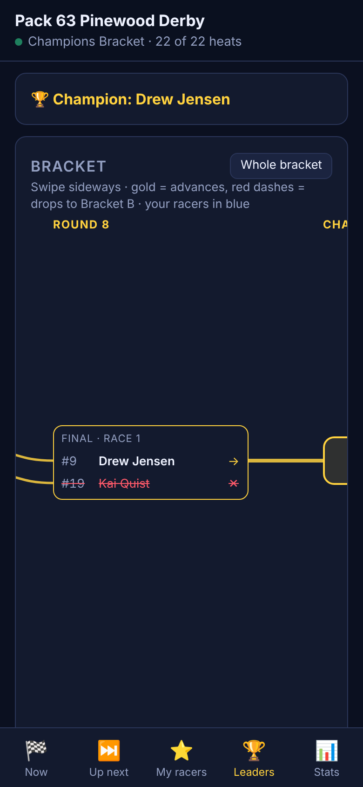
</p>

### 8.6 After the event
- **Standings → Download results CSV** for your records. If Sheets sync is set up, the results are
  already in your spreadsheet; **Push to Google Sheets now** forces a final upload.
- Back up the database ([Appendix C](#c-backups-and-where-things-live)).
- Shut boxes down cleanly when you can (`sudo poweroff` over SSH). Pulling the power is usually fine,
  but SD cards prefer a clean shutdown.

---

## Part 9 — Troubleshooting

| Symptom | Check |
|---|---|
| A box says **"searching the network for the brain…"** forever | Is it on the same network as the brain (same router or switch)? Guest or "isolated" Wi-Fi blocks discovery. Did both boxes get the **same fleet passphrase**? (`/etc/gravitygate/agent.json`) Is the brain's page showing *Brain running*? |
| **Two brains** warning | Someone pressed **B** on a second box. Press **B** on the wrong one to turn its brain role off. |
| Display box shows the setup page, not the race | Wait 20–30 s after assigning (the browser starts slowly the first time). Then check `/var/lib/gravitygate/logs/display.log` on that box. |
| Display box screen is black | Press **Ctrl+Alt+F1** to see the setup page. If the role line says *Display restarting* or *failed*, the browser couldn't start: check the log above, and that `cage` and `chromium` installed (`which cage chromium chromium-browser`). |
| Timer: **Timer port no** on the finish-line box | Re-seat the USB-serial adapter. `ls /dev/ttyUSB* /dev/ttyACM*` over SSH should list it. Some cheap adapters need a different cable (null-modem vs straight) — check your timer's manual. |
| Raw timer log shows lines but no times fill in | Wrong **Timer model** — try *Generic*. Still nothing: open an issue with a few raw lines. Use **Manual Entry** meanwhile. |
| Raw timer log stays empty | Wrong baud rate (pick the right **Timer model**), timer not powered, or the gate's reset switch isn't wired to the timer. Test with `gravitygate timer-capture` ([Appendix D](#d-command-line-reference)). |
| **Camera no** on the finish-line box | Power off, re-seat the ribbon (contacts toward the board), power on. `rpicam-hello --list-cameras` over SSH should list it. USB webcams are detected but can't capture yet; use a Pi camera. |
| Photos show the wrong moment or miss a car | Re-do the camera check ([4.3](#43-calibrate-the-camera)); make sure lanes are horizontal stripes and cars cross left→right. Raise **Post-roll** if the last car is missing. |
| Phones can't open the QR link | Phones must be on the event Wi-Fi, not mobile data. If the address in the QR is wrong, set **Public URL** in Settings. |
| Race control asks for a PIN | Someone set an **Admin PIN** in Settings; enter it once per browser. |
| Results aren't appearing in the Google Sheet | The status line in **Settings → Google Sheets** shows the last error. Check the Apps Script URL, that the secret matches the script, and that the deployment's access is *Anyone*. Without internet, results wait and upload later. |
| A box got the wrong role | Change it in **Admin → Fleet**, on the brain's Fleet screen, or with its own keyboard (**S** clears it). |
| Something is stuck | Every role restarts itself if it crashes. As a last resort: `sudo systemctl restart gravitygate-agent` on that box, or power-cycle it. Race data lives on the brain and is safe. |

Logs, on any box: `journalctl -u gravitygate-agent -f`, plus one file per role in `/var/lib/gravitygate/logs/`
(`brain.log`, `finish.log`, `display.log`).

---

## Appendix

### A. One-computer setup (no fleet)
Everything on one Pi or laptop: race control, timer and projector.

```bash
git clone https://github.com/Matt-Koch/gravity-gate.git && cd gravity-gate
./deploy/install.sh hub        # Raspberry Pi: installs a service that starts on boot
# or, on any computer with Python 3.11+:
python3 -m venv .venv && . .venv/bin/activate && pip install -e .
gravitygate serve
```
Plug the timer's USB-serial adapter into this computer (Timer source *Automatic* finds it). Open
`http://localhost:8000/display` full-screen on the projector, and `/admin` for race control.
`./deploy/install.sh node …` sets up a separate finish-line Pi without fleet mode; see the comments
at the top of [`deploy/install.sh`](../deploy/install.sh).

### B. Updating Gravity Gate
On each box (or on the master box before re-imaging):
```bash
cd /opt/gravity-gate && sudo git pull
sudo .venv/bin/pip install -e ".[camera]"
sudo systemctl restart gravitygate-agent
```
Update the brain and the finish-line box together, so they speak the same version.

### C. Backups and where things live

| What | Where (fleet box) |
|---|---|
| Race database (racers, heats, every result) | `/var/lib/gravitygate/data/derby.sqlite3` on the **brain** |
| Finish photos | `/var/lib/gravitygate/data/photos/` on the brain |
| This box's saved roles | `/var/lib/gravitygate/agent.json` |
| Logs | `/var/lib/gravitygate/logs/`, `journalctl -u gravitygate-agent` |
| Fleet passphrase, options | `/etc/gravitygate/agent.json` |
| The software | `/opt/gravity-gate` |

**Backup:** copy `derby.sqlite3` to a USB stick or laptop (`scp yourname@gg-0b11.local:/var/lib/gravitygate/data/derby.sqlite3 .`).
The results CSV and the Google Sheet are good human-readable backups too.

**Reset a box to factory:** press **S** on it (Standby), or `sudo rm /var/lib/gravitygate/agent.json && sudo systemctl restart gravitygate-agent`.

### D. Command-line reference

| Command | Purpose |
|---|---|
| `gravitygate identify` | Print this box's ID, IP and detected hardware. |
| `gravitygate timer-capture --serial /dev/ttyUSB0 --profile generic --lanes 3` | Show raw timer output and how it parses. Set the box to **Standby** first so the port is free. |
| `gravitygate agent` | The fleet service (normally run by systemd on tty1). |
| `gravitygate serve --port 8000 --data DIR` | Race server only (what the Brain role runs). |
| `gravitygate node --hub ws://BRAIN:8000 --serial PORT --profile MODEL --camera pi` | Finish-line node only (what the Finish line role runs). |
| `gravitygate demo-roster --data DIR --count 30` | Fill a database with fictional racers for practice. |

### E. Network reference
- **TCP 8000:** web (race control, projector, phones) and the WebSocket links between boxes.
- **UDP 47263:** discovery broadcasts. Boxes must be on the same subnet; broadcasts don't cross routers.
- Box hostnames: `gg-<id>.local` (e.g. `gg-a3f2.local`), reachable from most laptops and phones.

### F. Supported timers
Micro Wizard Fast Track, Champ, SmartLine / eTekGadget, NewBold DT8000 / Turbo, PDT and Arduino timers, plus
**Generic**, which understands most output formats. These profiles are written from published manuals and
haven't all been tested on real hardware, so check yours with the raw timer log during your rehearsal.
